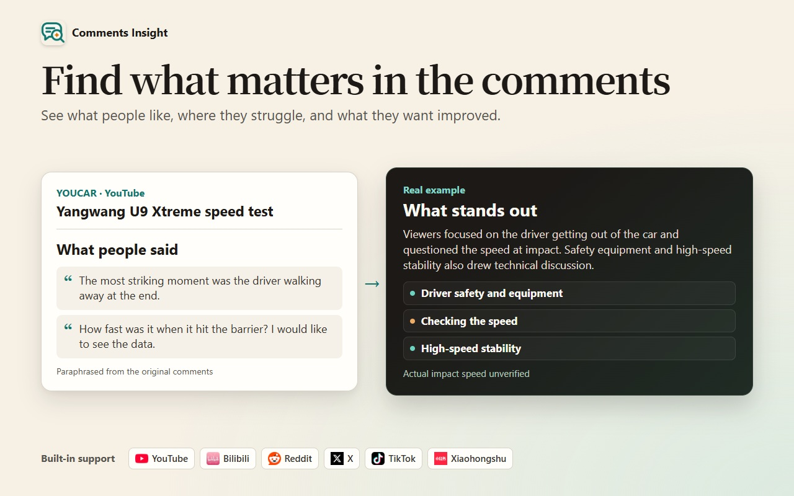
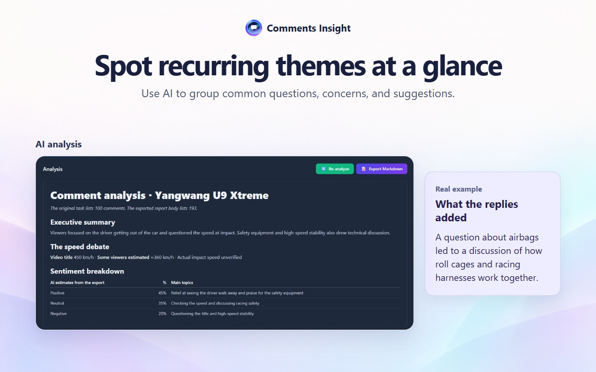
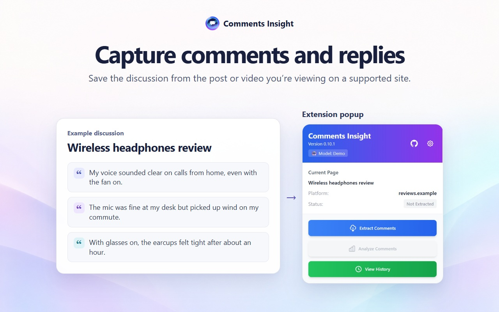
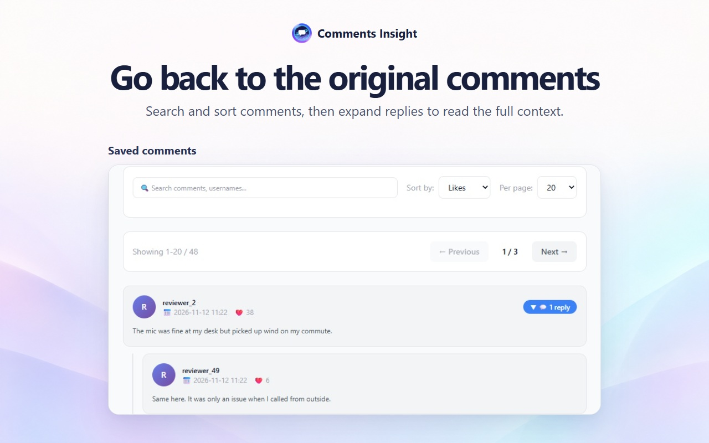
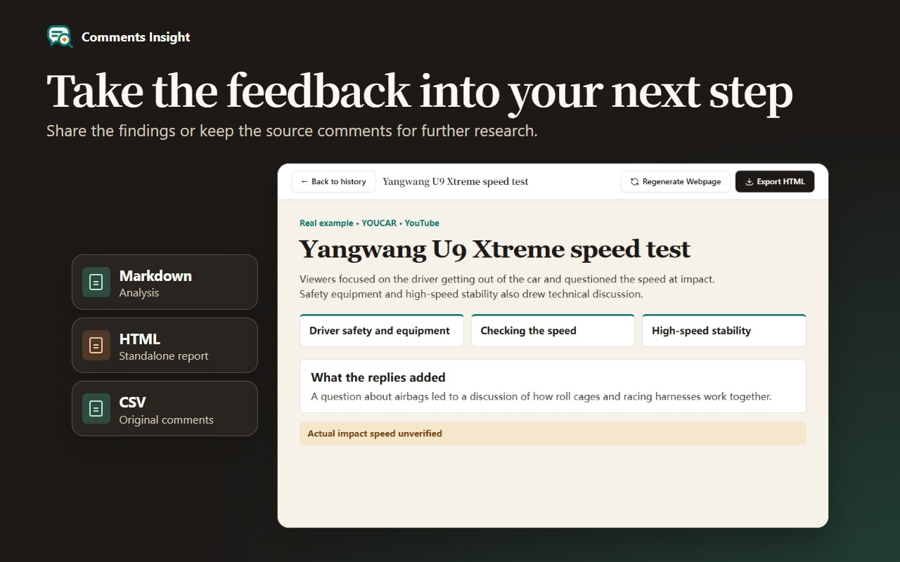

<div align="center">
  
</div>

<div align="center">

# Comments Insight

Extract comments and replies from supported webpages. Use your configured AI service to identify recurring topics and sentiment, then export a visual report as HTML.

**English** · [简体中文](README.zh-CN.md) · [Privacy Policy](PRIVACY.md)

[](https://chromewebstore.google.com/detail/comments-insight/dabladpkeglokmgppgicnbnajlipgfap) [](https://opensource.org/licenses/MIT) [](https://www.typescriptlang.org/) [](https://react.dev/) [](https://vitejs.dev/) [](https://crxjs.dev/vite-plugin/)

</div>

The instructions below cover **v0.10.1**. The Chrome Web Store listing shows the version it currently distributes. [GitHub release v0.10.1](https://github.com/cyber-tao/comments-insight/releases/tag/v0.10.1)

## 📚 Table of Contents

- [Comments Insight](#comments-insight)
  - [📚 Table of Contents](#-table-of-contents)
  - [🔎 Overview](#-overview)
  - [📸 Screenshots](#-screenshots)
  - [✨ Features](#-features)
  - [🔑 API Key Security Note](#-api-key-security-note)
  - [🧱 Architecture](#-architecture)
  - [📦 Project Structure](#-project-structure)
  - [🚀 Quick Start](#-quick-start)
    - [Install from Chrome Web Store](#install-from-chrome-web-store)
    - [Install the GitHub Release](#install-the-github-release)
    - [Build from Source](#build-from-source)
  - [🧭 Usage](#-usage)
    - [Configure an AI Service](#configure-an-ai-service)
    - [Using the Extension](#using-the-extension)
  - [⚙️ Configuration](#️-configuration)
  - [🧰 Tech Stack](#-tech-stack)
  - [🛠️ Commands](#️-commands)
  - [🤝 Contributing](#-contributing)
  - [📝 License](#-license)

## 🔎 Overview

- Manifest V3 Chrome extension with multi-page UI: Popup, Options, History, Logs.
- Built with Vite, React, TypeScript, and `@crxjs/vite-plugin`.
- Collects comments and nested replies using site rules with AI-assisted selector setup, streams analysis progress, and produces Markdown analyses and visual HTML reports.
- Persists history in Dexie-backed IndexedDB with lightweight metadata paging and search, plus local task/log storage.

## 📸 Screenshots

<a href="images/screenshots/en-US/00-cover.jpg">
  
</a>

The screenshots follow the discussion on YOUCAR’s Yangwang U9 Xtreme speed-test video. Comment excerpts are anonymized paraphrases, and the analysis and dashboard are adapted from the original exports. [Source video](https://www.youtube.com/watch?v=uxdE0I-VaFc)

<table>
  <tr>
    <td width="50%">
      <a href="images/screenshots/en-US/01-analysis.jpg">
        
      </a>
    </td>
    <td width="50%">
      <a href="images/screenshots/en-US/02-collect.jpg">
        
      </a>
    </td>
  </tr>
  <tr>
    <td width="50%">
      <a href="images/screenshots/en-US/03-comments.jpg">
        
      </a>
    </td>
    <td width="50%">
      <a href="images/screenshots/en-US/04-export.jpg">
        
      </a>
    </td>
  </tr>
</table>

## ✨ Features

- 🧲 **Comment extraction.** Use built-in or custom site rules to collect comments and nested replies. AI-assisted rule generation checks selectors against the page before saving them. The popup shows progress, and extraction tasks stop if their source page changes.
- 🧠 **AI Analysis**:
  - **Scalable Processing**: Automatically batches large comment sets with concurrency control (up to 3 concurrent requests) to handle long threads efficiently.
  - **Streaming Responses**: Streams Chat Completions output, keeps long requests alive with activity-based timeouts, and shows live receiving progress in Popup and History actions.
  - **Thought Filtering**: Supports reasoning models (like DeepSeek) by automatically stripping `<think>` tags from output for clean reports.
  - **Invalid Output Guard**: Empty model responses are rejected and retried instead of being stored as successful blank reports.
  - Comprehensive reports including Sentiment Distribution, Hot Comments, Top Discussed, and Interaction Analysis.
  - **Dynamic Visual Reports** (enabled by default): generates a visual HTML dashboard through a second model call, strips scripts, forms, frames, event handlers, and external URLs, then renders the static result in a network-blocked sandbox.
  - The default analysis and report prompts follow the selected language. You can edit either template or reset it to the default.
- 🧩 **Scraper Config**:
  - Automatically generate/edit/import/export per-site configs.
  - Visual selector validation and caching for performance.
- 🗂️ **History & Logs**:
  - **Token Tracking**: Locally records token usage stats for better cost management.
  - IndexedDB history storage with metadata-only paging and search for fast browsing.
  - Sanitized AI/system logs with local inspection tools for debugging.
  - Searchable history with filtering and sorting (by Time, Likes, Replies).
- 🌐 **Languages.** English, Simplified Chinese, Traditional Chinese, Japanese, Korean, French, European Portuguese, and Spanish. Choose a language in Options.
- 🎨 **Theme Support**: Light, Dark, and System modes with automatic theme switching.
- 🛠️ **Developer Mode**: Toggle advanced features like AI Logs and Selector Testing tools.

## 🔑 API Key Security Note

API keys are encrypted in local extension storage. The same browser profile holds the encryption material, so anyone with access to that profile can potentially recover the key. Settings exports omit the key. Importing a different API endpoint without a new key clears the stored credential.

The extension sends credentials and any data needed for the requested AI operation directly to your configured endpoint. Remote endpoints require HTTPS. Loopback development endpoints can use HTTP. Enter the final API URL because the extension rejects redirects. [Privacy Policy](PRIVACY.md)

## 🧱 Architecture

- **Background**: The Service Worker runs migrations before initializing `TaskManager`, owns streaming `AIService` calls, and persists data through stores injected by `ServiceContainer`. UI requests use `START_*` messages; background jobs send validated `RUN_*` commands to content scripts.
- **Content Scripts**: Accept validated content-only commands, perform abortable DOM traversal and `MutationObserver`-powered interactions, and return extraction/configuration outcomes to the background task.
- **Popup**: Main control center for triggering tasks, viewing page status, and monitoring granular real-time progress.
- **Options**: Configuration for AI models (OpenAI-compatible services and local endpoints), prompts, and scraper management.
- **History**: Browses Dexie-backed extraction records, reruns analysis, monitors streaming progress, and exports sanitized reports.
- **Sandbox**: An opaque-origin, network-blocked iframe that sanitizes model-generated HTML and renders only static HTML/CSS without `chrome.*` APIs or extension-page privileges.

## 📦 Project Structure

```
src/
  background/            # Service Worker
    ai/                  # AI helpers: CommentAnalyzer, PromptBuilder, TimestampNormalizer
    handlers/            # Message handlers: extraction, analysis, config, history, settings, task, misc
    storage/             # Dexie/chrome.storage stores + DataMigrator
  content/               # Content Scripts
    handlers/            # Message handlers: extraction, config-generation, dom, tools
    prompts.ts           # Extraction/config prompts bundled into the content chunk
    strategies/          # AIStrategy, ConfiguredStrategy, AIConfigGenerator
    utils/               # Chunker, abort helpers
  popup/                 # Extension popup UI
  options/               # Options page: settings & scraper configs
  history/               # History page: browsing & re-analysis
  logs/                  # Debug logs viewer
  sandbox/               # Sandboxed page for rendering LLM-generated dynamic reports
  config/
    constants/           # Themed constants (ai, dom, extraction, timing, ui, ...)
    default_rules.json   # Default crawling rules bundle
  components/            # Shared UI components (Toast, ConfirmDialog)
  hooks/                 # Shared React hooks (useTheme, useToast, useConfirm)
  utils/                 # Shared utilities (Logger, Export, validation, tokenizer, ...)
  types/                 # TypeScript definitions
  locales/               # Application translations for eight locales
  styles/                # Global CSS with Tailwind
vite.config.ts          # Build config
vitest.config.ts        # Test config
```

## 🚀 Quick Start

### Install from Chrome Web Store

**[📦 Install from Chrome Web Store →](https://chromewebstore.google.com/detail/comments-insight/dabladpkeglokmgppgicnbnajlipgfap)**

Comments Insight requires Chrome 116 or later. Choose **Add to Chrome** on the store listing to install the version currently available there.

### Install the GitHub Release

1. Download `extension.zip` from the [v0.10.1 release](https://github.com/cyber-tao/comments-insight/releases/tag/v0.10.1) and extract it.
2. Open `chrome://extensions` and enable **Developer mode**.
3. Click **Load unpacked** and select the extracted folder containing `manifest.json`. Pin the extension to open the popup from the toolbar.

### Build from Source

Use Node.js 20.19 or later in the 20.x series, or Node.js 22.12 or later. The repository uses Bun 1.4.4.

Run these commands from the repository root.

```bash
bun install --frozen-lockfile
bun run build
```

At `chrome://extensions`, enable **Developer mode** and select `dist` using **Load unpacked**. For live development, use `bun run dev`.

## 🧭 Usage

### Configure an AI Service

AI-assisted rule generation, analysis, and visual reports require an OpenAI-compatible Chat Completions endpoint.

1. Open **Options** from the extension's toolbar menu and go to **AI Model**.
2. Enter the service's **API URL** and its **API Key** if required. Enter a model ID or select one using **Fetch Available Models**.
3. Click **Test Model**. A successful test confirms that the extension can reach the configured model.

### Using the Extension

1. Open a post or video with comments and click the extension icon.
2. Select **Extract Comments** when a rule is available. If the popup offers **Generate Config**, generate a rule with your AI service and then run extraction.
3. After extraction finishes, select **View Comments** to see the saved discussion. With an AI service configured, select **Analyze Comments** to generate a report.
4. Open **View History** to find saved results. Export comments as CSV, analysis as Markdown, and visual reports as HTML.

## ⚙️ Configuration

- **AI Model.** Configure the endpoint, model ID, context window, and output token limit to match the service you use.
- **DOM Analysis**: Configure advanced parameters like `initialDepth`, `expandDepth`, and `maxDepth` for complex pages.
- **Prompts**: Customize labels/placeholders like `{comments_data}`, `{post_content}`, etc.
- **Developer Mode**: Enable in Settings to see "View AI Logs" and selector testing tools.

## 🧰 Tech Stack

- **Framework**: React 19.2, Vite 6.4
- **Language**: TypeScript 5.9 (strict mode)
- **Styling**: TailwindCSS 3.4 with dark mode support
- **Extension**: Manifest V3, CRXJS 2.4
- **i18n**: i18next 25.6 + react-i18next 16.5
- **Markdown**: react-markdown 10.1 + remark-gfm 4.0
- **Storage**: Dexie 4.4 backed by IndexedDB
- **Testing**: Vitest 4.1 with unit and [E2E tests](docs/e2e-testing.md) (Puppeteer 24.42)
- **Code Quality**: ESLint 9.39 + Prettier 3.6

## 🛠️ Commands

- `bun run dev`: Start dev server with HMR
- `bun run build`: Production build (TypeScript check + Vite build)
- `bun run preview`: Preview production build
- `bun run package`: Build and package for distribution (.zip)
- `bun run typecheck`: Run TypeScript checks
- `bun run lint`: Run ESLint and verify localization coverage
- `bun run i18n:check`: Check the eight interface catalogs and Chrome metadata
- `bun run lint:fix`: Run ESLint with auto-fix
- `bun run format`: Format code with Prettier
- `bun run format:check`: Check formatting with Prettier
- `bun run test`: Run unit tests
- `bun run test:coverage`: Run tests and enforce coverage thresholds
- `bun run test:e2e`: Run the built extension against the local browser E2E fixture
- `bun run version:check`: Verify package, manifest, and release-tag version consistency
- `bun run audit`: Check high severity production dependency issues

## 🤝 Contributing

Report bugs and request features in [GitHub Issues](https://github.com/cyber-tao/comments-insight/issues). Before submitting a code change, run `bun run version:check`, `bun run format:check`, `bun run typecheck`, `bun run lint`, `bun run test:coverage`, and `bun run build`. See the [browser E2E guide](docs/e2e-testing.md) for `bun run test:e2e`.

## 📝 License

[MIT License](LICENSE)
