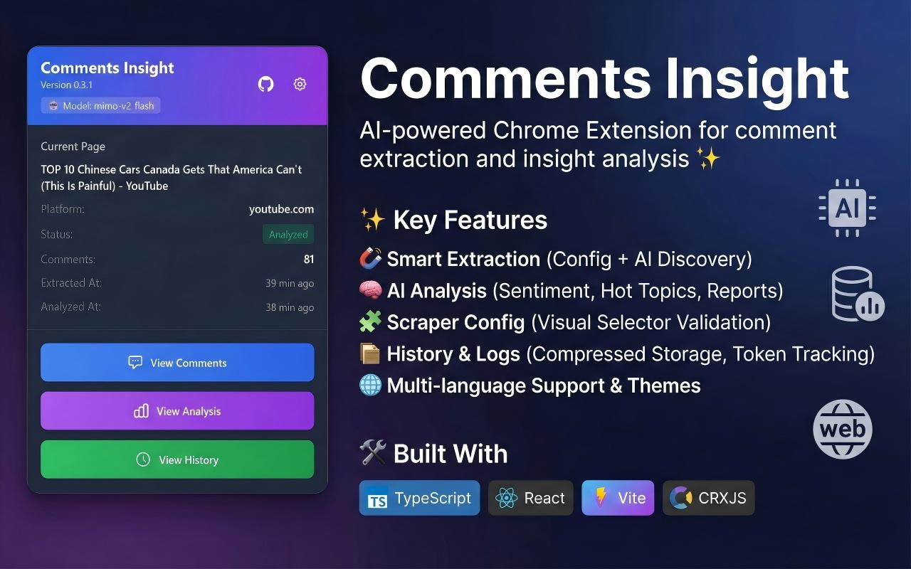
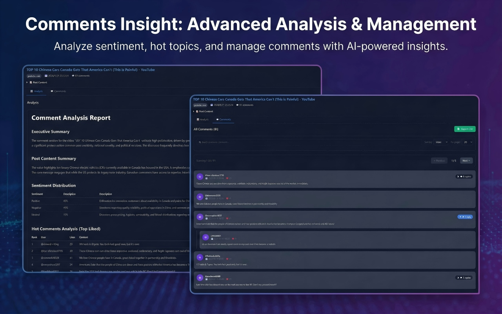
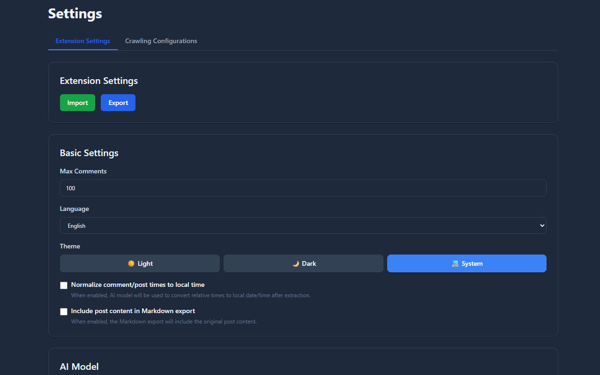
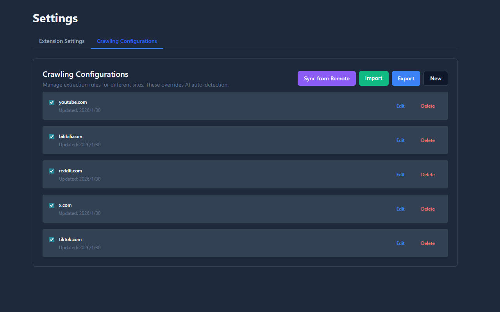
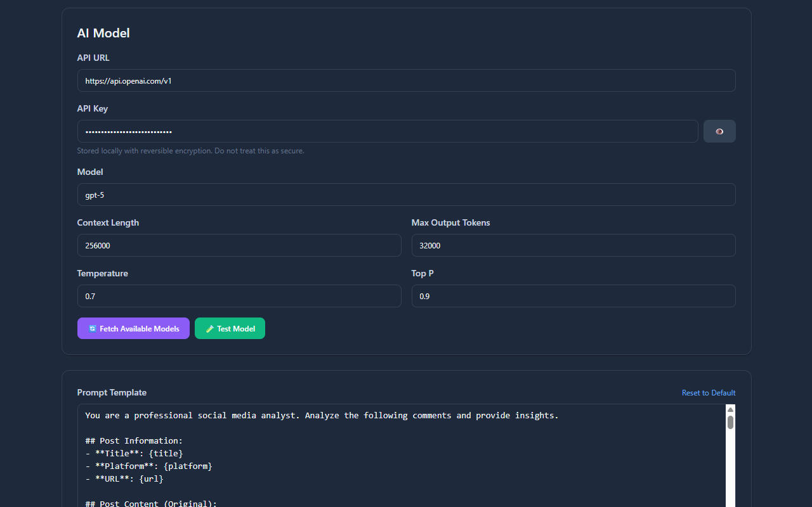

<div align="center">
  
</div>

<div align="center">

# Comments Insight

AI-powered Chrome Extension for comment extraction and insight analysis ✨

[English](README.md) | [简体中文](README.zh-CN.md) | [Privacy](PRIVACY.md)

[](https://chromewebstore.google.com/detail/comments-insight/dabladpkeglokmgppgicnbnajlipgfap) [](https://opensource.org/licenses/MIT) [](https://www.typescriptlang.org/) [](https://react.dev/) [](https://vitejs.dev/) [](https://crxjs.dev/vite-plugin/)

</div>

> Extract comments from the web, analyze them with AI, and generate actionable, structured insights.

## 📚 Table of Contents

- [Comments Insight](#comments-insight)
  - [📚 Table of Contents](#-table-of-contents)
  - [🔎 Overview](#-overview)
  - [📸 Screenshots](#-screenshots)
  - [✨ Features](#-features)
  - [🔑 API Key Security Note](#-api-key-security-note)
  - [🧱 Architecture](#-architecture)
  - [📦 Project Structure](#-project-structure)
  - [🚀 Quick Start](#-quick-start)
    - [Install from Chrome Web Store](#install-from-chrome-web-store)
    - [Build from Source](#build-from-source)
  - [🧭 Usage](#-usage)
    - [Getting Started with OpenRouter (Free Option)](#getting-started-with-openrouter-free-option)
    - [Using the Extension](#using-the-extension)
  - [⚙️ Configuration](#️-configuration)
  - [🧰 Tech Stack](#-tech-stack)
  - [🛠️ Commands](#️-commands)
  - [🤝 Contributing](#-contributing)
  - [📝 License](#-license)

## 🔎 Overview

- Manifest V3 Chrome extension with multi-page UI: Popup, Options, History, Logs.
- Built with Vite, React, TypeScript, and `@crxjs/vite-plugin`.
- Combines selectors and AI to robustly extract comments (including nested replies), stream AI analysis progress, and produce comprehensive Markdown reports with tables and structured data.
- Persists history in Dexie-backed IndexedDB with lightweight metadata paging and search, plus local task/log storage.

## 📸 Screenshots

<table>
  <tr>
    <td width="50%">
      
      <p align="center"><em>Extension Popup</em></p>
    </td>
    <td width="50%">
      
      <p align="center"><em>AI Analysis Report</em></p>
    </td>
  </tr>
</table>

<table>
  <tr>
    <td width="33.3%">
      
      <p align="center"><em>Options Settings</em></p>
    </td>
    <td width="33.3%">
      
      <p align="center"><em>Scraper Configuration</em></p>
    </td>
    <td width="33.3%">
      
      <p align="center"><em>AI Configuration</em></p>
    </td>
  </tr>
</table>

## ✨ Features

- 🧲 **Smart Extraction**:
  - Hybrid approach using Config + AI Discovery for robust selector detection.
  - **Self-Correcting AI**: Two-phase AI generation (macro for post metadata, micro for comment fields) that instantly validates hallucinated CSS selectors against the live DOM.
  - **Intelligent DOM Waiting**: Uses `MutationObserver` to precisely detect when lazy-loaded content or nested replies are fully mounted, instead of relying on static delays.
  - Real-time granular progress tracking (e.g., "Verifying AI-generated schema...", "Extracting (55/100)").
- 🧠 **AI Analysis**:
  - **Scalable Processing**: Automatically batches large comment sets with concurrency control (up to 3 concurrent requests) to handle long threads efficiently.
  - **Streaming Responses**: Streams Chat Completions output, keeps long requests alive with activity-based timeouts, and shows live receiving progress in Popup and History actions.
  - **Thought Filtering**: Supports reasoning models (like DeepSeek) by automatically stripping `<think>` tags from output for clean reports.
  - **Invalid Output Guard**: Empty model responses are rejected and retried instead of being stored as successful blank reports.
  - Comprehensive reports including Sentiment Distribution, Hot Comments, Top Discussed, and Interaction Analysis.
  - **Dynamic Visual Reports** (enabled by default): generates a visual HTML dashboard through a second model call, strips scripts, forms, frames, event handlers, and external URLs, then renders the static result in a network-blocked sandbox.
  - Customizable prompt templates with "Reset to Default" capability.
- 🧩 **Scraper Config**:
  - Automatically generate/edit/import/export per-site configs.
  - Visual selector validation and caching for performance.
- 🗂️ **History & Logs**:
  - **Token Tracking**: Locally records token usage stats for better cost management.
  - IndexedDB history storage with metadata-only paging and search for fast browsing.
  - Sanitized AI/system logs with local inspection tools for debugging.
  - Searchable history with filtering and sorting (by Time, Likes, Replies).
- 🌐 **i18n**: English, Simplified Chinese, Traditional Chinese, Japanese, Korean, French, European Portuguese, and Spanish.
- 🎨 **Theme Support**: Light, Dark, and System modes with automatic theme switching.
- 🛠️ **Developer Mode**: Toggle advanced features like AI Logs and Selector Testing tools.

## 🔑 API Key Security Note

API keys are encrypted in local extension storage, but the key material is stored in the same browser profile. This prevents accidental plaintext exposure; it is **not** a strong security boundary against malware or another actor with local access. Settings exports never include the API key, and importing a different API endpoint without a new key clears the stored key.

AI-powered extraction, selector generation, analysis, model discovery, and visual reports send the API key and relevant page or report data directly to the endpoint selected by the user. Remote endpoints must use HTTPS; plain HTTP is allowed only for loopback development services. See the [Privacy Policy](PRIVACY.md) for the complete data-flow disclosure.

## 🧱 Architecture

- **Background**: The Service Worker runs migrations before initializing `TaskManager`, owns streaming `AIService` calls, and persists data through stores injected by `ServiceContainer`. UI requests use `START_*` messages; background jobs send validated `RUN_*` commands to content scripts.
- **Content Scripts**: Accept validated content-only commands, perform abortable DOM traversal and `MutationObserver`-powered interactions, and return extraction/configuration outcomes to the background task.
- **Popup**: Main control center for triggering tasks, viewing page status, and monitoring granular real-time progress.
- **Options**: Configuration for AI models (OpenAI-compatible services and local endpoints), prompts, and scraper management.
- **History**: Browses Dexie-backed extraction records, reruns analysis, monitors streaming progress, and exports sanitized reports.
- **Sandbox**: An opaque-origin, network-blocked iframe that sanitizes model-generated HTML and renders only static HTML/CSS without `chrome.*` APIs or extension-page privileges.

## 📦 Project Structure

```
src/
  background/            # Service Worker
    ai/                  # AI helpers: CommentAnalyzer, PromptBuilder, TimestampNormalizer
    handlers/            # Message handlers: extraction, analysis, config, history, settings, task, misc
    storage/             # Dexie/chrome.storage stores + DataMigrator
  content/               # Content Scripts
    handlers/            # Message handlers: extraction, config-generation, dom, tools
    prompts.ts           # Extraction/config prompts bundled into the content chunk
    strategies/          # AIStrategy, ConfiguredStrategy, AIConfigGenerator
    utils/               # Chunker, abort helpers
  popup/                 # Extension popup UI
  options/               # Options page: settings & scraper configs
  history/               # History page: browsing & re-analysis
  logs/                  # Debug logs viewer
  sandbox/               # Sandboxed page for rendering LLM-generated dynamic reports
  config/
    constants/           # Themed constants (ai, dom, extraction, timing, ui, ...)
    default_rules.json   # Default crawling rules bundle
  components/            # Shared UI components (Toast, ConfirmDialog)
  hooks/                 # Shared React hooks (useTheme, useToast, useConfirm)
  utils/                 # Shared utilities (Logger, Export, validation, tokenizer, ...)
  types/                 # TypeScript definitions
  locales/               # Application translations for eight locales
  styles/                # Global CSS with Tailwind
vite.config.ts          # Build config
vitest.config.ts        # Test config
```

## 🚀 Quick Start

### Install from Chrome Web Store

**[📦 Install from Chrome Web Store →](https://chromewebstore.google.com/detail/comments-insight/dabladpkeglokmgppgicnbnajlipgfap)**

Visit the Chrome Web Store to install the extension with one click.

### Build from Source

1. **Prerequisites**: Node.js 20.19+ or 22.12+, Bun 1.3.11+, Chrome 116+.
2. **Install dependencies**:
   ```bash
   bun install
   ```
3. **Development build**:
   ```bash
   bun run dev
   ```
4. **Load into Chrome**:
   - Open `chrome://extensions`
   - Enable **Developer mode** (top right)
   - Click **Load unpacked** and select the `dist` folder
5. **Production build**:
   ```bash
   bun run build
   ```

## 🧭 Usage

### Getting Started with OpenRouter (Free Option)

OpenRouter provides access to various AI models, including free options. Here's how to set it up:

1. **Get API Key**:
   - Visit [OpenRouter](https://openrouter.ai/)
   - Sign up or log in to your account
   - Go to [Keys](https://openrouter.ai/keys) page
   - Click "Create API Key" and copy your API key

2. **Configure Extension**:
   - Click the extension icon and select "Options" (or right-click the icon → Options)
   - In the **AI Model Settings** section:
     - **API URL**: Enter `https://openrouter.ai/api/v1`
     - **API Key**: Paste your OpenRouter API key (settings are saved automatically)
     - **Model**: Select a model from the dropdown list
       - 💡 **Tip**: Models ending with `:free` are completely free to use (e.g., `z-ai/glm-4.5-air:free`, `stepfun/step-3.5-flash:free`)
       - Browse all free models at [OpenRouter Free Models Collection](https://openrouter.ai/collections/free-models)

3. **Verify Configuration**:
   - Scroll down to the **Test AI Connection** section
   - Click "Test Connection" button
   - You should see a success message confirming the API is working
   - If you see an error, double-check your API key and URL

### Using the Extension

1. **Navigate**: Go to a post or video page with comments (e.g., YouTube, Reddit, Bilibili).
2. **Extract**: Click the extension icon. If a config exists, click "Extract Comments". If not, click "Generate Config" to let AI find selectors.
3. **Monitor**: Watch the progress bar in the popup.
4. **Analyze**: Once extracted, click "Analyze Comments" and watch the streamed response progress.
5. **View**: Click "View History" to see detailed comments, rerun analysis, and export the report.

## ⚙️ Configuration

- **AI Model**: Any OpenAI-compatible Chat Completions endpoint (OpenAI, DeepSeek, Kimi, Qwen, OpenRouter, Ollama, vLLM, etc.). Remote URLs require HTTPS; loopback development endpoints may use HTTP.
- **DOM Analysis**: Configure advanced parameters like `initialDepth`, `expandDepth`, and `maxDepth` for complex pages.
- **Prompts**: Customize labels/placeholders like `{comments_data}`, `{post_content}`, etc.
- **Developer Mode**: Enable in Settings to see "View AI Logs" and selector testing tools.

## 🧰 Tech Stack

- **Framework**: React 19.2, Vite 6.4
- **Language**: TypeScript 5.9 (strict mode)
- **Styling**: TailwindCSS 3.4 with dark mode support
- **Extension**: Manifest V3, CRXJS 2.4
- **i18n**: i18next 25.6 + react-i18next 16.5
- **Markdown**: react-markdown 10.1 + remark-gfm 4.0
- **Storage**: Dexie 4.4 backed by IndexedDB
- **Testing**: Vitest 4.1 with unit and [E2E tests](docs/e2e-testing.md) (Puppeteer 24.42)
- **Code Quality**: ESLint 9.39 + Prettier 3.6

## 🛠️ Commands

- `bun run dev`: Start dev server with HMR
- `bun run build`: Production build (TypeScript check + Vite build)
- `bun run preview`: Preview production build
- `bun run package`: Build and package for distribution (.zip)
- `bun run typecheck`: Run TypeScript checks
- `bun run lint`: Run ESLint
- `bun run lint:fix`: Run ESLint with auto-fix
- `bun run format`: Format code with Prettier
- `bun run format:check`: Check formatting with Prettier
- `bun run test`: Run unit tests
- `bun run test:coverage`: Run tests and enforce coverage thresholds
- `bun run test:e2e`: Run the built extension against the local browser E2E fixture
- `bun run version:check`: Verify package, manifest, and release-tag version consistency
- `bun run audit`: Check high severity production dependency issues

## 🤝 Contributing

Issues and PRs are welcome! Before submitting, run `bun run version:check`, `bun run format:check`, `bun run typecheck`, `bun run lint`, `bun run test:coverage`, and `bun run build`. Run `bun run test:e2e` after the build when a supported local browser is available.

## 📝 License

MIT License
