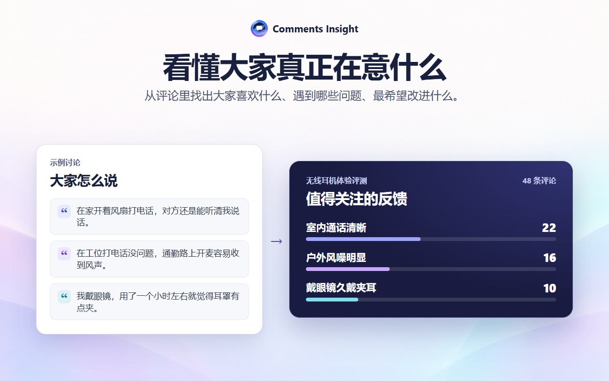
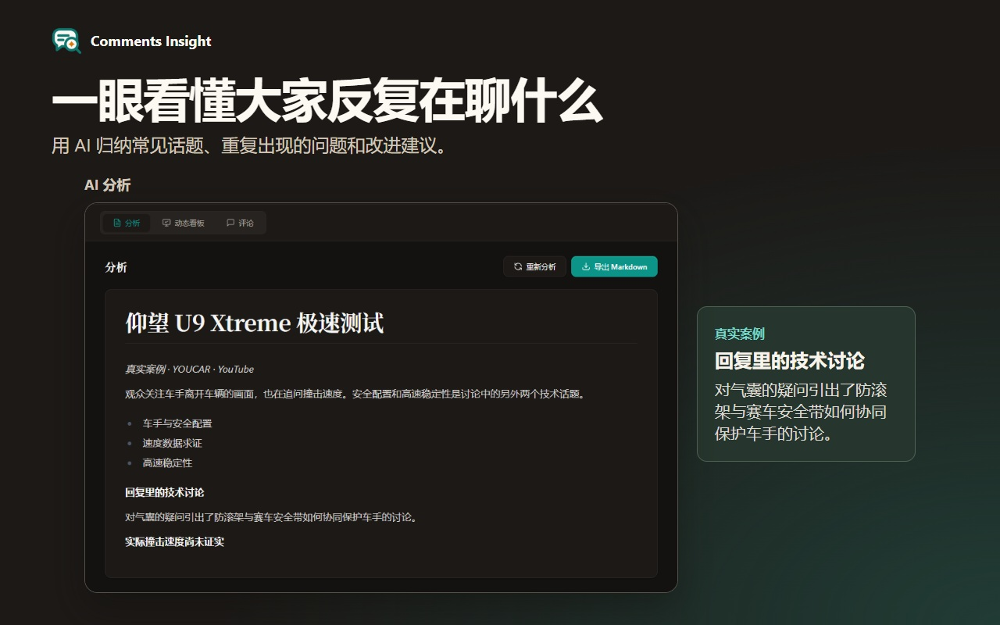
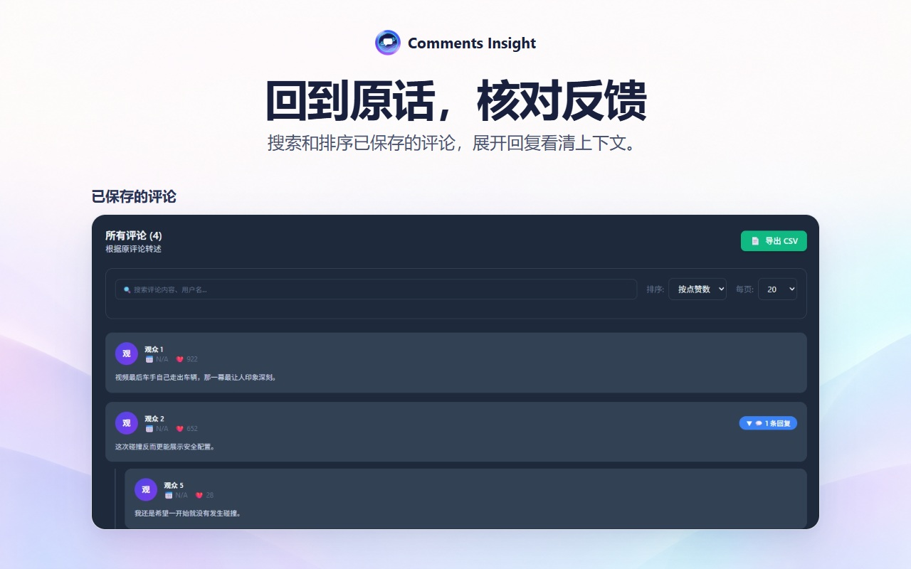

<div align="center">
  
</div>

<div align="center">

# 评论洞察 (Comments Insight)

从受支持的网页中提取评论和回复，用你配置的 AI 服务找出常见话题和情绪倾向，并生成可导出的 HTML 报告。

[English](README.md) · **简体中文** · [隐私政策](PRIVACY.zh-CN.md)

[](https://chromewebstore.google.com/detail/comments-insight/dabladpkeglokmgppgicnbnajlipgfap) [](https://opensource.org/licenses/MIT) [](https://www.typescriptlang.org/) [](https://react.dev/) [](https://vitejs.dev/) [](https://crxjs.dev/vite-plugin/)

</div>

本文适用于 **v0.10.1**。Chrome 网上应用店页面会显示当前可安装的版本。 [GitHub v0.10.1 发布页](https://github.com/cyber-tao/comments-insight/releases/tag/v0.10.1)

## 📚 目录

- [评论洞察 (Comments Insight)](#评论洞察-comments-insight)
  - [📚 目录](#-目录)
  - [🔎 概览](#-概览)
  - [📸 演示截图](#-演示截图)
  - [✨ 核心功能](#-核心功能)
  - [🔑 API 密钥安全说明](#-api-密钥安全说明)
  - [🧱 架构设计](#-架构设计)
  - [📦 项目结构](#-项目结构)
  - [🚀 快速开始](#-快速开始)
    - [从 Chrome 网上应用店安装](#从-chrome-网上应用店安装)
    - [从 GitHub 发布页安装](#从-github-发布页安装)
    - [从源码构建](#从源码构建)
  - [🧭 使用方法](#-使用方法)
    - [配置 AI 服务](#配置-ai-服务)
    - [使用扩展](#使用扩展)
  - [⚙️ 配置说明](#️-配置说明)
  - [🧰 技术栈](#-技术栈)
  - [🛠️ 开发命令](#️-开发命令)
  - [🤝 贡献指南](#-贡献指南)
  - [📝 开源协议](#-开源协议)

## 🔎 概览

- 基于 Manifest V3 的 Chrome 扩展，包含 Popup、选项页、历史记录和日志视图。
- 使用 Vite、React、TypeScript 和 `@crxjs/vite-plugin` 构建。
- 结合站点规则与 AI 辅助选择器配置提取评论和嵌套回复，展示实时分析进度，并生成 Markdown 分析和可视化 HTML 报告。
- 使用 Dexie 驱动的 IndexedDB 保存历史记录，支持轻量元数据分页与搜索，并在本地保存任务和日志。

## 📸 演示截图

<a href="images/screenshots/zh-CN/00-cover.jpg">
  
</a>

下方用 YOUCAR 仰望 U9 Xtreme 极速测试视频展示如何归纳讨论。评论节选已匿名转述，分析与看板依据原始导出整理。 [原视频](https://www.youtube.com/watch?v=uxdE0I-VaFc)

<table>
  <tr>
    <td width="50%">
      <a href="images/screenshots/zh-CN/01-analysis.jpg">
        
      </a>
    </td>
    <td width="50%">
      <a href="images/screenshots/zh-CN/02-collect.jpg">
        
      </a>
    </td>
  </tr>
  <tr>
    <td width="50%">
      <a href="images/screenshots/zh-CN/03-comments.jpg">
        
      </a>
    </td>
    <td width="50%">
      <a href="images/screenshots/zh-CN/04-export.jpg">
        
      </a>
    </td>
  </tr>
</table>

## ✨ 核心功能

- 🧲 **评论提取**。使用内置或自定义站点规则收集评论和嵌套回复。AI 辅助生成的规则会先在当前页面验证选择器，再保存。弹窗显示提取进度，来源页面变化时，提取任务会停止。
- 🧠 **AI 分析**:
  - **大规模并发处理**: 自动对长评论流进行分批处理，支持多达 3 个并发请求，大幅提升分析速度。
  - **流式响应**: 使用 Chat Completions 流式输出，通过响应活动刷新超时计时，并在弹窗和历史记录操作中显示实时接收进度。
  - **思考过程过滤**: 自动识别并移除 DeepSeek 等推理模型产生的 `<think>` 标签，确保报告内容纯净。
  - **无效输出防护**: 空模型响应会被拒绝并重试，不会再保存为空白的成功报告。
  - 全方位报告：包含情感分布、热门评论、核心议题和互动分析。
  - **动态可视化报告**（默认开启）：通过第二次模型调用生成 HTML 仪表盘，移除脚本、表单、框架、事件处理器和外部 URL 后，在禁止联网的沙箱中渲染静态结果。
  - 分析和报告的默认提示词随界面语言切换。两种模板都可以编辑或恢复为默认值。
- 🧩 **爬虫配置**:
  - 支持按站点全自动生成、编辑、导入/导出爬取配置。
  - 可视化选择器验证与性能缓存。
- 🗂️ **历史与日志**:
  - **Token 消耗统计**: 本地记录每次 AI 调用的 Token 消耗，帮助掌握使用成本。
  - 使用 IndexedDB 保存历史记录，并通过元数据分页和搜索提升列表浏览性能。
  - 对 AI/系统日志进行敏感信息清洗，并提供本地调试查看工具。
  - 支持搜索、过滤和排序（时间、点赞数、回复数）。
- 🌐 **多语言支持**。在扩展选项中可选择简体中文、繁体中文、英语、日语、韩语、法语、葡萄牙语（葡萄牙）或西班牙语。
- 🎨 **主题支持**: 支持亮色、暗色和跟随系统三种主题模式，自动切换。
- 🛠️ **开发者模式**: 可开启 AI 日志详细视图和选择器测试工具。

## 🔑 API 密钥安全说明

API 密钥以加密形式保存在扩展的本地存储中。用于加密的数据也存于同一浏览器配置文件中，能访问该配置文件的人有可能恢复密钥。导出的设置不包含 API 密钥。若导入的设置指定了不同的 API 端点，且未提供新密钥，扩展会清除已保存的密钥。

执行 AI 操作时，扩展会将凭证及该操作所需的数据直接发送到你配置的端点。远程端点须使用 HTTPS，本地回环地址上的开发服务可使用 HTTP。扩展会拒绝重定向，请填写最终的 API URL。 [隐私政策](PRIVACY.zh-CN.md)

## 🧱 架构设计

- **Background（后台）**: Service Worker 先执行数据迁移，再初始化 `TaskManager`，统一处理流式 `AIService` 调用，并通过 `ServiceContainer` 注入的 Store 持久化数据。UI 使用 `START_*` 消息创建任务，后台任务再向内容脚本发送经过验证的 `RUN_*` 命令。
- **Content Scripts（内容脚本）**: 只接受经过验证的内容端命令，执行可取消的 DOM 遍历和 `MutationObserver` 交互，并把提取或配置结果返回后台任务。
- **Popup（弹窗）**: 控制中心，用于触发任务、查看页面状态以及监控细粒度实时进度。
- **Options（选项）**: 配置 OpenAI 兼容服务或本地 AI 端点、提示词和爬虫规则。
- **History（历史）**: 浏览基于 Dexie 保存的提取记录、重新分析、监控流式进度并导出经过清洗的报告。
- **Sandbox（沙箱）**: 禁止联网的不透明源 iframe；对模型生成的 HTML 进行清洗，只渲染静态 HTML/CSS，不具备 `chrome.*` API 或扩展页面权限。

## 📦 项目结构

```
src/
  background/            # Service Worker
    ai/                  # AI 辅助：CommentAnalyzer、PromptBuilder、TimestampNormalizer
    handlers/            # 消息处理器：extraction、analysis、config、history、settings、task、misc
    storage/             # Dexie/chrome.storage 存储 + DataMigrator
  content/               # 内容脚本
    handlers/            # 消息处理器：extraction、config-generation、dom、tools
    prompts.ts           # 随内容脚本打包的抽取/配置提示词
    strategies/          # AIStrategy、ConfiguredStrategy、AIConfigGenerator
    utils/               # Chunker、abort 辅助
  popup/                 # 扩展弹窗 UI
  options/               # 选项页：设置与爬取配置
  history/               # 历史页：浏览与重新分析
  logs/                  # 调试日志查看器
  sandbox/               # 沙箱页：渲染 LLM 生成的动态报告
  config/
    constants/           # 按主题分文件的常量（ai、dom、extraction、timing、ui 等）
    default_rules.json   # 默认爬取规则
  components/            # 共用 UI 组件（Toast、ConfirmDialog）
  hooks/                 # 共用 React Hooks（useTheme、useToast、useConfirm）
  utils/                 # 共用工具（Logger、Export、validation、tokenizer 等）
  types/                 # TypeScript 类型定义
  locales/               # 扩展界面的八套语言资源
  styles/                # 全局 CSS（含 Tailwind）
vite.config.ts          # 构建配置
vitest.config.ts        # 测试配置
```

## 🚀 快速开始

### 从 Chrome 网上应用店安装

**[📦 从 Chrome 网上应用店安装 →](https://chromewebstore.google.com/detail/comments-insight/dabladpkeglokmgppgicnbnajlipgfap)**

Comments Insight 需要 Chrome 116 或更高版本。在商店页面点击 **添加至 Chrome**，即可安装商店当前提供的版本。

### 从 GitHub 发布页安装

1. 在 [v0.10.1 发布页](https://github.com/cyber-tao/comments-insight/releases/tag/v0.10.1)下载并解压 `extension.zip`。
2. 打开 `chrome://extensions`，启用 **开发者模式**。
3. 点击 **加载已解压的扩展程序**，选择包含 `manifest.json` 的解压目录。将扩展固定到工具栏后，即可从工具栏打开弹窗。

### 从源码构建

使用 Node.js 20.19 及以上的 20.x 版本，或 Node.js 22.12 及以上版本。项目使用 Bun 1.4.4。

在仓库根目录运行以下命令。

```bash
bun install --frozen-lockfile
bun run build
```

打开 `chrome://extensions` 并启用 **开发者模式**，通过 **加载已解压的扩展程序** 选择 `dist`。开发时可用 `bun run dev` 启动热更新。

## 🧭 使用方法

### 配置 AI 服务

AI 辅助生成规则、评论分析和可视化报告需要兼容 OpenAI Chat Completions 的 API 端点。

1. 从工具栏的扩展菜单打开 **选项**，进入 **AI 模型**。
2. 填入服务的 **API URL**。如果服务要求认证，再填入 **API密钥**。输入模型 ID，或点击 **获取可用模型** 后选择模型。
3. 点击 **测试模型**。测试成功表示扩展可以调用已配置的模型。

### 使用扩展

1. 打开有评论的帖子或视频，点击扩展图标。
2. 已有站点规则时，点击 **提取评论**。如果弹窗显示 **生成配置**，可先用你配置的 AI 服务生成规则，再提取评论。
3. 提取完成后，点击 **查看评论** 浏览保存的讨论。配置了 AI 服务后，可点击 **分析评论** 生成报告。
4. 打开 **历史记录** 查找保存的结果。评论可导出为 CSV，分析结果可导出为 Markdown，可视化报告可导出为 HTML。

## ⚙️ 配置说明

- **AI 模型**。根据所用服务配置端点、模型 ID、上下文长度和输出 Token 上限。
- **DOM 分析**。针对复杂页面，可配置 `initialDepth`、`expandDepth` 和 `maxDepth` 等高级参数。
- **提示词**: 可通过 `{comments_data}`, `{post_content}` 等占位符自定义分析逻辑。
- **开发者模式**: 开启后可在弹窗中查看“AI 日志”和选择器测试工具。

## 🧰 技术栈

- **框架**: React 19.2, Vite 6.4
- **语言**: TypeScript 5.9（严格模式）
- **样式**: TailwindCSS 3.4（支持暗色模式）
- **扩展协议**: Manifest V3, CRXJS 2.4
- **国际化**: i18next 25.6 + react-i18next 16.5
- **Markdown**: react-markdown 10.1 + remark-gfm 4.0
- **存储**: Dexie 4.4 + IndexedDB
- **测试**: Vitest 4.1 单元测试 + [E2E 测试](docs/e2e-testing.md)（Puppeteer 24.42）
- **代码质量**: ESLint 9.39 + Prettier 3.6

## 🛠️ 开发命令

- `bun run dev`: 启动开发服务器（支持 HMR）
- `bun run build`: 正式打包构建（TypeScript 检查 + Vite 构建）
- `bun run preview`: 预览生产构建
- `bun run package`: 构建并打包发布（生成 .zip）
- `bun run typecheck`: 执行 TypeScript 类型检查
- `bun run lint` 运行 ESLint 并检查本地化覆盖情况。
- `bun run i18n:check` 检查八套界面翻译和 Chrome 扩展元数据。
- `bun run lint:fix`: 执行代码检查并自动修复
- `bun run format`: 使用 Prettier 格式化代码
- `bun run format:check`: 使用 Prettier 检查格式
- `bun run test`: 运行单元测试
- `bun run test:coverage`: 运行测试并强制执行覆盖率阈值
- `bun run test:e2e`: 使用本地浏览器和测试页面验证已构建的扩展
- `bun run version:check`: 校验 package、manifest 和发布 tag 的版本一致性
- `bun run audit`: 检查生产依赖中的高危安全问题

## 🤝 贡献指南

欢迎在 [GitHub Issues](https://github.com/cyber-tao/comments-insight/issues)反馈问题或提出功能建议。提交代码变更前，请运行 `bun run version:check`、`bun run format:check`、`bun run typecheck`、`bun run lint`、`bun run test:coverage` 和 `bun run build`。运行 `bun run test:e2e` 的方法见[浏览器端到端测试指南（英文）](docs/e2e-testing.md)。

## 📝 开源协议

[MIT 许可证](LICENSE)
